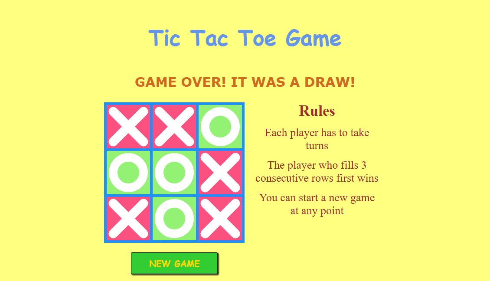
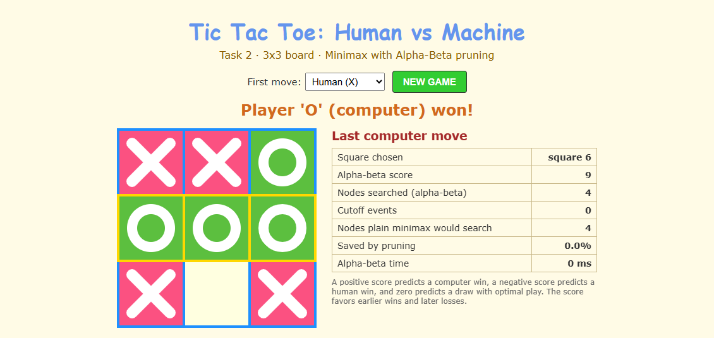
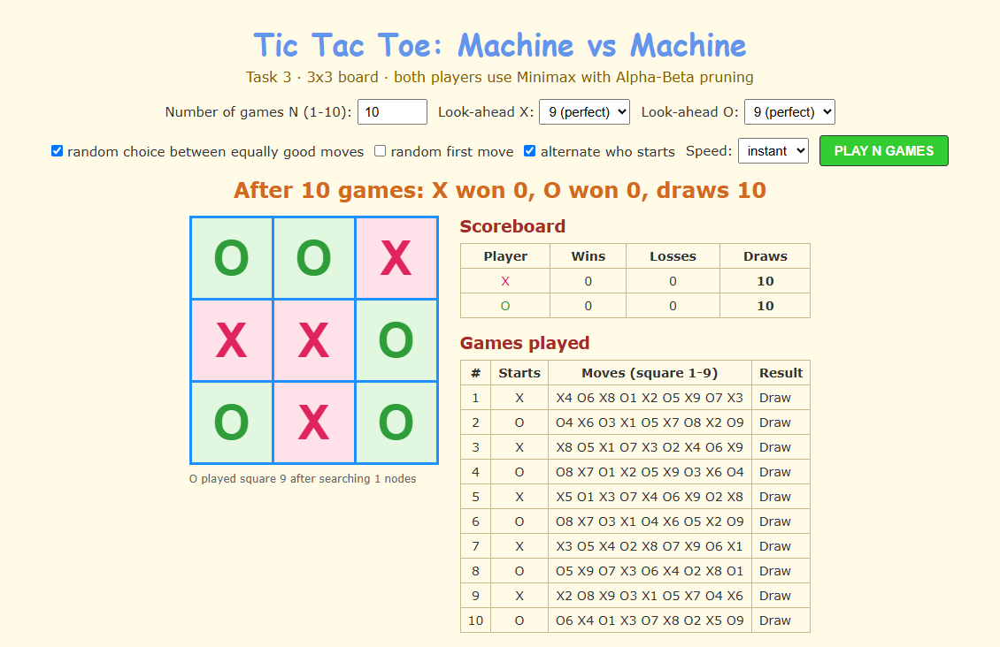
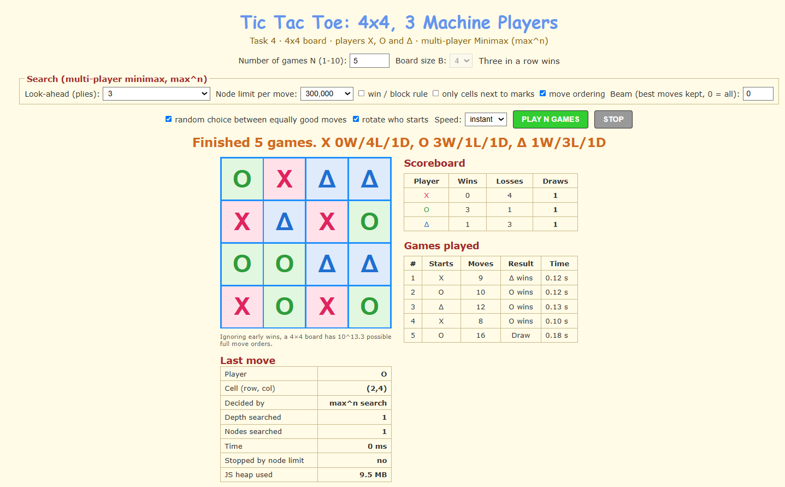
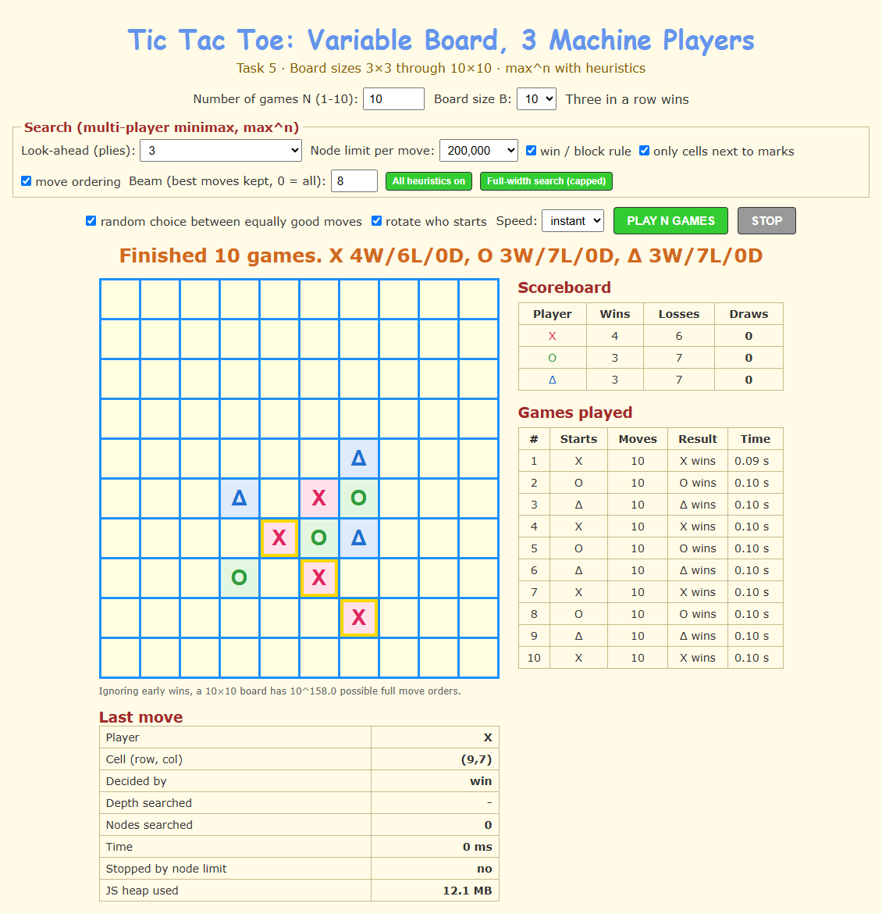

# TicTacToe - Adversarial Search

Five browser-based JavaScript tasks explore Minimax, alpha-beta pruning, and three-player Maxⁿ.

The first player to place **three consecutive matching marks** horizontally, vertically, or diagonally wins. A full board without a winner is a draw. This rule also applies to boards larger than 3×3.

## Run the games

Clone this repository and open any task's `index.html` in a browser. The browser games work locally without a server or dependencies.

| Task | Open | Players and board | Search |
|---|---|---|---|
| 1 | [Task1/index.html](Task1/index.html) | Human X and computer O, 3×3 | Supplied plain Minimax sample |
| 2 | [Task2/index.html](Task2/index.html) | Human X and computer O, 3×3 | Full-depth alpha-beta with an unpruned comparison |
| 3 | [Task3/index.html](Task3/index.html) | Two computers, 3×3 | Alpha-beta with independent depth controls |
| 4 | [Task4/index.html](Task4/index.html) | Three computers, 4×4 | Maxⁿ with depth and node limits |
| 5 | [Task5/index.html](Task5/index.html) | Three computers, 3×3 through 10×10 | Maxⁿ with selectable heuristics |

For example, open the repository in VS Code and use its PowerShell terminal to launch a task:

```powershell
Invoke-Item .\Task2\index.html
```

Use `Task1` through `Task5` in that command to open each game. For Tasks 3–5, choose a game count from 1 through 10 and press **PLAY N GAMES**. Each player's wins, losses, and draws add up to the number of completed games. A three-player win credits one win and two opponent losses.

## How the tasks work

### Task 1 — The supplied baseline

The human starts as X. `script.js` handles canvas drawing, legal moves, win detection, and recursive Minimax. The computer temporarily tries possible moves and evaluates terminal results as +10 for an O win, -10 for an X win, and 0 for a draw.

The starter files retain the instructor-provided implementation and its Packt license. The game's on-screen rules use imprecise wording about rows. Its code checks the eight standard winning lines.

### Task 2 — Alpha-beta pruning

`engine.js` contains the search and `script.js` connects it to the browser. O maximizes the score and X minimizes it. Alpha-beta skips remaining siblings once the bounds show that they cannot improve an ancestor's decision. Candidates are ordered center, corners, then edges.

Terminal scores use `10 - ply` for an O win and `ply - 10` for an X win, favoring earlier wins and later losses. The engine runs plain Minimax separately to show a node-count comparison. The displayed search time measures the alpha-beta call.

The included exhaustive test explores every human response against the deterministic computer, with either side starting. It completes **613 games with zero computer losses**. From an empty board, alpha-beta visits **7,865 nodes** and plain Minimax visits **549,946**.

### Task 3 — Machine versus machine

Both players call the alpha-beta engine. Their depths can be set independently from 1 to 9 plies. One ply is one individual move. Depth 9 reaches terminal positions on a 3×3 board. Shallower searches estimate positions from open lines, weighting two marks more heavily than one.

The page can randomize equally valued moves, choose a random opening, and alternate the starter. Full-depth play produces draws. A smaller depth can also draw because its heuristic still identifies useful defensive moves.

### Task 4 — Three players with Maxⁿ

X, O, and Δ take turns on a 4×4 board. The engine precomputes 24 contiguous three-cell winning windows, including diagonals away from the corners.

Each search result is a vector `[scoreX, scoreO, scoreDelta]`. The player to move selects the child with the highest score in its own component and propagates the whole vector. At depth-limited leaves, each player's value is its own open-line potential minus the strongest opponent's potential.

The default settings use three plies, all legal candidates, move ordering, and a **300,000-node budget per move**. The browser can stop between moves. An unfinished game contributes no score.

### Task 5 — Larger boards and heuristics

The same three-player engine supports board sizes 3×3 through 10×10. Its default preset uses:

- Immediate wins and a block of the next player's sole immediate winning cell.
- Empty cells next to existing marks, including diagonal neighbors.
- Quick move ordering and a beam of up to eight candidates at each level.
- Three-ply iterative deepening with a **200,000-node budget per move**.

If the budget interrupts an iteration, the engine uses the last fully completed depth. The **Full-width search (capped)** preset considers every legal candidate, disables the tactical and neighborhood shortcuts and ordering, and searches toward terminal positions with a **500,000-node budget**.

Beam width is the number of ranked candidates retained at each level. A width of 0 retains all candidates allowed by the other settings. Beam and neighborhood filtering trade search coverage for lower cost. The depth and node limits make the larger games approximate searches.

## Reproduce and verify

Use **Node.js 20 or newer** for command-line verification. The scripts use Node's built-in modules and the existing task engines. They have no package dependencies.

```sh
node scripts/verify.cjs
node scripts/reproduce.cjs
node scripts/reproduce.cjs --check
```

The equivalent npm commands are `npm test`, `npm run reproduce`, and `npm run reproduce:check`.

- Verification runs the original Task 2 test, checks both alpha-beta engines against an independent reference, and validates three-player winning windows and budget behavior.
- Reproduction runs seeded Task 2 examples, both Task 3 depth configurations, ten Task 4 games, ten Task 5 games at each board size, and one capped full-width trial.
- Results are written to `.results/latest.json`. The check command compares deterministic results with the committed [baseline](experiments/baseline.json).

See [REPRODUCIBILITY.md](REPRODUCIBILITY.md) for the seeds, recorded fields, commands, browser procedure, and interpretation of the results.

## Evidence

Each task includes its screenshots and, for Tasks 2–5, a browser session log. These capture the original browser trials. The seeded command-line baseline is an additional experiment using the same search engines. It has its own move sequences and outcomes.

### Task 1 — Human versus Minimax



### Task 2 — Alpha-beta computer win



### Task 3 — Two full-depth computers



### Task 4 — Three players on a 4×4 board

The Task 4 screenshot currently named `task4-10games.png` shows a **five-game run**. Its accompanying session log records a **separate ten-game run**. The screenshot's game count is visible in its scoreboard.



### Task 5 — Three players on a 10×10 board



## Code organization and attribution

`index.html` and `style.css` provide the interface. Tasks 2 and 3 separate their engines from `script.js`. Tasks 4 and 5 keep identical copies of `engineN.js` and `uiN.js` so each task folder runs independently. The verification script checks these shared copies for consistency.

Task 1 comes from the supplied Packt Tic-Tac-Toe sample. Its original [MIT license](Task1/LICENSE.txt) and [README](Task1/README.md.txt) are retained. Tasks 2–5 are the group project's extensions.
